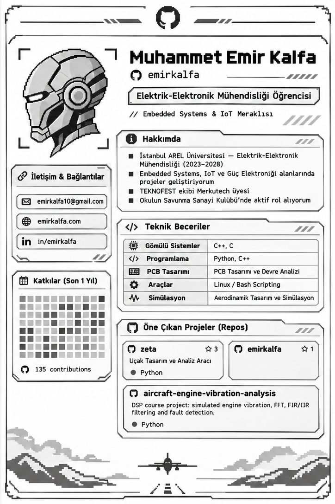

<picture>
  <source media="(prefers-color-scheme: dark)" srcset="./assets/dark.png">
  
</picture>

İletişim ve proje bağlantıları

[E-posta](mailto:emirkalfa10@gmail.com) · [Web sitesi](https://emirkalfa.com) · [LinkedIn](https://www.linkedin.com/in/emirkalfa/)

- [zeta — Uçak Tasarım ve Analiz Aracı](https://github.com/emirkalfa/zeta)
- [emirkalfa — Profil deposu](https://github.com/emirkalfa/emirkalfa)
- [aircraft-engine-vibration-analysis — Uçak motoru titreşim analizi](https://github.com/emirkalfa/aircraft-engine-vibration-analysis)

