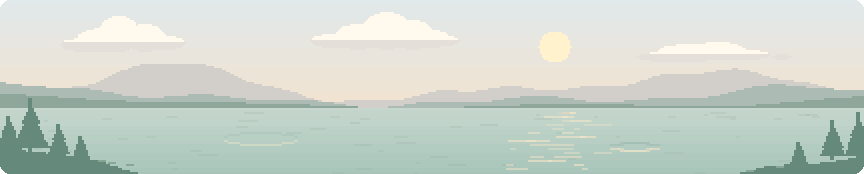

<table>
<tr>
<td valign="top" width="32%" align="center">

<h3>Contact</h3>
<a href="mailto:emirkalfa10@gmail.com"><picture><source media='(prefers-color-scheme: dark)' srcset='./assets/email-triangle-dark.svg'></picture></a> 
<a href="https://www.linkedin.com/in/muhammet-emir-kalfa-a88a80293/"><picture><source media='(prefers-color-scheme: dark)' srcset='./assets/linkedin-triangle-dark.svg'></picture></a>&nbsp;<a href="https://emirkalfa.com"><picture><source media='(prefers-color-scheme: dark)' srcset='./assets/web-triangle-dark.svg'></picture></a>
</td>
<td valign="top">
<picture><source media="(prefers-color-scheme: dark)" srcset="./assets/identity-dark.svg"></picture>

<picture><source media="(prefers-color-scheme: dark)" srcset="./assets/about-dark.svg"></picture>

I study electrical and electronics engineering at Istanbul Arel University. I <strong>lead the avionics team at Merkutech</strong>, our university’s TEKNOFEST team.

<ul>
<li>I develop <strong><a href="https://github.com/emirkalfa/zeta">ZETA</a></strong>, a web app for designing fixed-wing drones. It combines parametric design, 3D modeling, and aerodynamic analysis.</li>
<li>I co-founded <strong><a href="https://complaintr.com">Complaintr</a></strong> and run operations for our AI-powered customer service platform.</li>
</ul>
<picture><source media="(prefers-color-scheme: dark)" srcset="./assets/skills-dark.svg"></picture>
<table>
<tr><th align="left">Embedded Systems</th><td>Embedded C, STM32, ESP32</td></tr>
<tr><th align="left">Programming</th><td>Python, C/C++</td></tr>
<tr><th align="left">Electronics</th><td>PCB design with KiCad</td></tr>
<tr><th align="left">Tools</th><td>Linux</td></tr>
<tr><th align="left">Simulation</th><td>Aerodynamic design and simulation</td></tr>
</table>
<h3>Featured Projects</h3>
<a href="https://github.com/emirkalfa/zeta"><picture><source media="(prefers-color-scheme: dark)" srcset="./assets/zeta-dark.svg"></picture></a> 
<a href="https://github.com/emirkalfa/aircraft-engine-vibration-analysis"><picture><source media="(prefers-color-scheme: dark)" srcset="./assets/vibration-dark.svg"></picture></a>
</td>
</tr>
</table>

<picture><source media="(prefers-reduced-motion: reduce) and (prefers-color-scheme: dark)" srcset="./assets/lake-ripples-dark.svg"><source media="(prefers-reduced-motion: reduce)" srcset="./assets/lake-ripples-light.svg"><source media="(prefers-color-scheme: dark)" srcset="./assets/lake-rounded-dark.gif"></picture>
