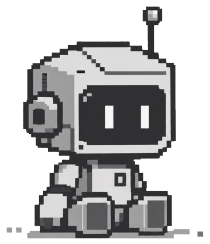

<table>
<tr>
<td valign="top" width="32%" align="center">

<h3>İletişim</h3>
<a href="mailto:emirkalfa10@gmail.com"><picture><source media='(prefers-color-scheme: dark)' srcset='./assets/email-compact-dark.svg'></picture></a> 
<a href="https://www.linkedin.com/in/muhammet-emir-kalfa-a88a80293/"><picture><source media='(prefers-color-scheme: dark)' srcset='./assets/linkedin-compact-dark.svg'></picture></a> 
<a href="https://emirkalfa.com"><picture><source media='(prefers-color-scheme: dark)' srcset='./assets/web-compact-dark.svg'></picture></a>
</td>
<td valign="top">
<picture><source media="(prefers-color-scheme: dark)" srcset="./assets/identity-dark.svg"></picture>

<picture><source media="(prefers-color-scheme: dark)" srcset="./assets/about-dark.svg"></picture>

İstanbul Arel Üniversitesi’nde Elektrik-Elektronik Mühendisliği okuyorum. Üniversitenin TEKNOFEST takımı <strong>Merkutech’te aviyonik takım kaptanıyım.</strong>

<ul>
<li><strong><a href="https://github.com/emirkalfa/zeta">ZETA</a></strong> ile sabit kanatlı İHA’lar için parametrik tasarım, 3B modelleme ve aerodinamik analizi tek bir web uygulamasında bir araya getiriyorum.</li>
<li><strong><a href="https://complaintr.com">Complaintr</a></strong>’ın kurucu ortağıyım. Yapay zekâ destekli müşteri hizmetleri platformumuzun operasyonlarını yürütüyorum.</li>
</ul>
<picture><source media="(prefers-color-scheme: dark)" srcset="./assets/skills-dark.svg"></picture>
<table>
<tr><th align="left">Gömülü Sistemler</th><td>Embedded C, STM32, ESP32</td></tr>
<tr><th align="left">Programlama</th><td>Python, C/C++</td></tr>
<tr><th align="left">Elektronik</th><td>KiCad ve PCB tasarımı</td></tr>
<tr><th align="left">Araçlar</th><td>Linux</td></tr>
<tr><th align="left">Simülasyon</th><td>Aerodinamik tasarım ve simülasyon</td></tr>
</table>
<h3>Öne Çıkan Projeler</h3>
<a href="https://github.com/emirkalfa/zeta"><picture><source media="(prefers-color-scheme: dark)" srcset="./assets/zeta-dark.svg"></picture></a> 
<a href="https://github.com/emirkalfa/aircraft-engine-vibration-analysis"><picture><source media="(prefers-color-scheme: dark)" srcset="./assets/vibration-dark.svg"></picture></a>
</td>
</tr>
</table>

<picture><source media='(prefers-color-scheme: dark)' srcset='./assets/horizon-dark.png'></picture>
